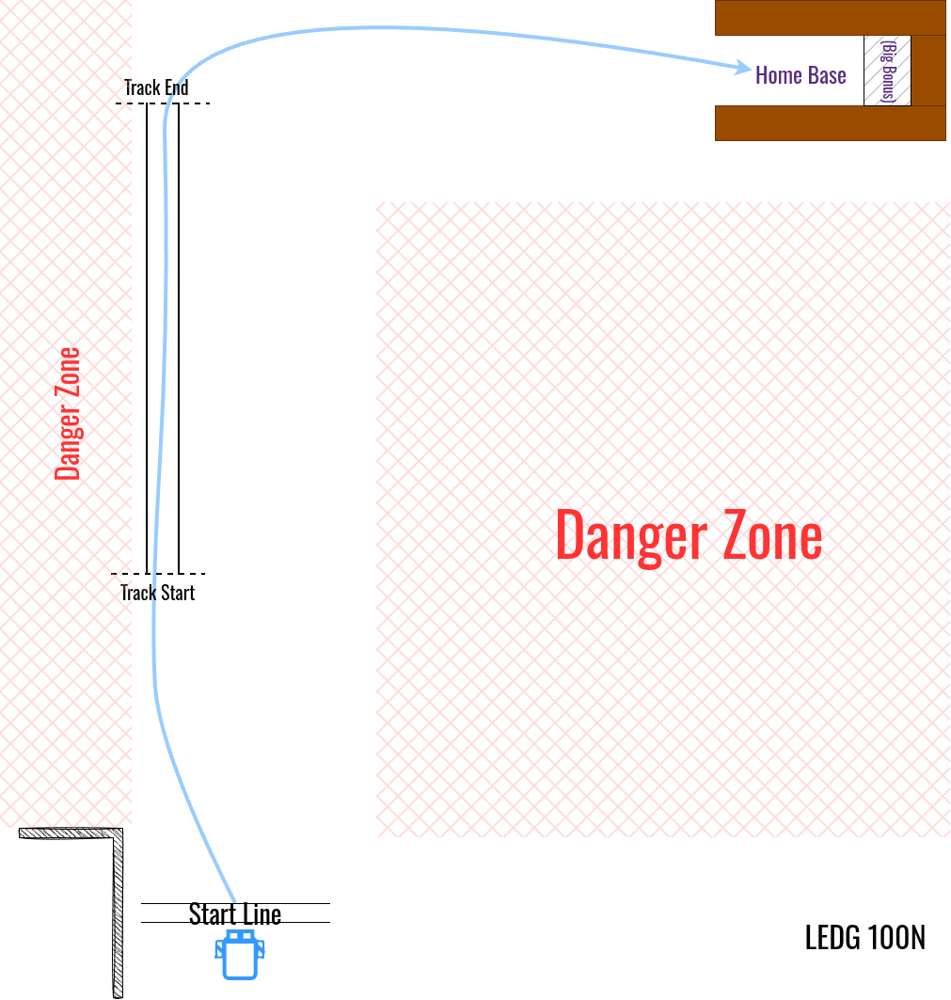

# Lab Rover
> [!IMPORTANT]
> ## $\color{#582c83}\text{Demonstration Due: Thursday, Dec. 10th @ 1 PM}$
> ## $\color{#582c83}\text{Submission Due: Thursday, Dec. 10th @ 5 PM}$

## 1. Background Story

On the surface of the planet LEDG-100n, our brave rover TBot has successfully secured a volatile sample of "Element M2-5", a crucial resource to build planetary engines.
Now begins the perilous return journey to the Base Station, a navigation challenge that would fry the circuits of lesser bots.
TBot must traverse the extraterrestrial terrain, relying on its sensors to differentiate between solid ground and deceptively steep cliffs.
The good news is, on the way to the sampling site, TBot memorized the surrounding environment and made a map.
TBot shared this information to its trustworthy human partner, you, and is waiting on a reliable plan to start the journey back home.

## 2. Autonomous Navigation Demonstration

### 2.1. Procedure
1. Power on the robot to run initialization and self-checks.
2. Receive the payload ("Element M2-5", a.k.a. **M2.5 nut**)
3. Place the robot behind the **Start Line** at any position and heading angle.
4. Start the run and allow the robot to navigate autonomously toward the destination.
5. $\color{purple}\text{Terminate}$ navigation once the robot determines it has reached the goal.

> [!IMPORTANT]
> ### 2.2. Rules, Bonuses, and Penalties
> - **Attempt Limit & Queue Priority:** Each student may make up to **3 attempts**. Students with fewer completed attempts receive higher priority in the queue. Only your highest-scoring trial will be kept.
> - **Success Criteria:** A trial is successful if the robot terminates inside the **Home Base** (see map below).
> - **Danger Zones (Disqualification):** Entering a **Danger Zone** disqualifies the attempt. The point of entry is recorded as the robot's final location.
> - **Human Intervention (Disqualification):** Physically touching the robot after it crosses the **Start Line** disqualifies the attempt. The point of contact is recorded as the robot's final location.
> - **Deep Home Base Bonus (+25%):** Reaching the deeper section of the **Home Base** earns **25% bonus points**.
> - **Rails Bonus (+5%):** Traveling between the **Rails** earns **5% bonus points** (at least one wheel must remain on the track).
> - **Incomplete Navigation Penalty (Up to -40%):** If the robot fails to finish inside the **Home Base**, the distance $d$ (in meters) will be measured from its final location to the nearest point on the **Home Base** entry line. A penalty of $\min(40, 10d)$% points will be deducted.
> - **Hardware Freedom:** You are free to incorporate any sensors and actuators introduced in this semester.

Reference map for the navigation:

## 3. Requirements
> [!CAUTION]
> A live demonstration is required to earn points for the sections below.

### 3.1. Mechanical Design & Implementation (15% Base)
- **(3%) Robot Assembly:** Assemble your robot and capture a portrait photo from an angle that clearly reveals as many key components as possible.
- **(12%) Engineering Drawings:** Provide *Top*, *Side*, and *Front* view drawings illustrating:
  - Dimensions of key components (base, wheels, circuit boards, **payload storage**, etc.).
  - Component placement and overall layout.

### 3.2. Electrical Design & Implementation (10% Base + 5% Bonus)
Wire all electrical and electronic components cleanly and reliably.
- **(10%) Wiring Schematics:** Provide wiring diagram(s) depicting both power distribution and signal connections.
- **(+5% Bonus) PCB Soldering:** Hand-solder the PCB for the TBot control.

### 3.3. Navigation Algorithm (10% Base + 5% Bonus)
- **(10%) Logic Documentation:** Describe your navigation logic using an [itemized list](https://docs.github.com/en/get-started/writing-on-github/getting-started-with-writing-and-formatting-on-github/basic-writing-and-formatting-syntax#lists), an [algorithm table](https://i.sstatic.net/6hfCG.png), or a [flowchart](https://upload.wikimedia.org/wikipedia/commons/thumb/9/91/LampFlowchart.svg/960px-LampFlowchart.svg.png).
- **(+5% Bonus) Sensor Fusion Formulation:** Fuse IMU measurements with wheel encoder data, and explain your sensor fusion approach using formal mathematical notation.

### 3.4. Software & Control (50% Base + 20% Bonus)
#### 3.4.1. (10%) Initialization (System Check)
- **(3%) Sensor Verification:** On power-up, verify that all active sensors are functional:
  - Tactile button GPIO reads its configured default resting logic level (`0` for `PULL_DOWN`, `1` for `PULL_UP`).
  - Ultrasonic sensor (if used) returns a valid, non-zero distance reading.
  - IMU (if used) returns reasonable motion data.
- **(7%) Actuator Verification:** Verify that all active actuators respond properly:
  - Rotate the mobile base exactly $90^\circ$ CW or CCW in place, then rotate it back to its original heading (this simultaneously verifies encoder feedback).
  - Rotate the servo (if used) exactly $90^\circ$ CW or CCW, then return it to its starting angle.
- **Completion Signal:** If all checks pass, blink all status LEDs simultaneously at 5 Hz for 2 seconds, then automatically transition into `PAUSE` mode.

> [!WARNING]
> If any initialization check fails, the robot **must not** proceed to active navigation.

#### 3.4.2. (3%) When `PAUSE` mode is activated:
- **(1%)** Stop all actuators immediately.
- **(1%)** Modulate the $\color{green}\text{green}$ LED with a breathing/fading effect at 1 Hz (allocating equal duration to fade-in and fade-out cycles).
- **(1%)** Transition to `WORK` mode the moment the tactile button is **released**.
  
#### 3.4.3. (32%) When `WORK` mode is activated:
- **(1%)** Keep the $\color{green}\text{green}$ LED solidly lit.
- **(30%)** Compute appropriate velocity commands from sensor feedback to navigate toward the goal.
- **(1%)** Transition back to `PAUSE` mode the moment the tactile button is **released**.

#### 3.4.4. (5%) Goal Termination
- Terminate navigation when the robot determines it has reached the destination, and illuminate a solid $\color{purple}\text{purple}$ LED to indicate completion.

#### 3.4.5. (+10% Bonus) Battery Voltage Monitoring
Adjust status LED brightness and system behavior dynamically based on battery voltage during `WORK` mode:
- **$\ge 8.4\text{ V}$:** $\color{green}\text{green}$ LED at 100% brightness ($\color{red}\text{red}$ LED off).
- **$7.4\text{ V}$ to $8.4\text{ V}$:** $\color{green}\text{green}$ LED scales from 50% to 100% brightness; $\color{red}\text{red}$ LED scales from 50% to 0% brightness.
- **$6.4\text{ V}$ to $7.4\text{ V}$:** $\color{green}\text{green}$ LED scales from 0% to 50% brightness; $\color{red}\text{red}$ LED scales from 100% to 50% brightness.
- **$< 6.4\text{ V}$:** Safely shut down the robot/system.

#### 3.4.6. (+10% Bonus) Sensor Fusion Implementation
- Implement your sensor fusion algorithm in code to improve state estimation during navigation.

### 3.5. Documentation (15% Base)

> [!CAUTION]
> All project documentation must be committed directly to your repository's root [`README.md`](README.md) file.

#### 3.5.1. (8%) Mechanical Drawings
- **(2%)** Display the portrait photo of your robot at a resolution of `800 x 600 px`.
- **(6%)** Display all engineering drawings (Top, Side, and Front views) at a resolution of `1200 x 900 px`.

#### 3.5.2. (4%) Wiring Diagrams
- Display your complete electrical wiring schematic(s).

#### 3.5.3. (2%) Algorithm Charts
- Document your navigation (and sensor fusion) algorithm using your chosen visual/structured format.

#### 3.5.4. (1%) AI Contribution Acknowledgment
- List all AI tools and contributions used during the development of this project.

## 4. Resources
- [Differential driver controller examples code](https://github.com/linzhangUCA/3421example-differential_drive_controller).
- [Distance sensor example code](https://github.com/linzhangUCA/3421example-ultrasonic_sensor).
- [IMU example code](https://github.com/linzhangUCA/3421example-inertial_measurement_unit).
- [Servo control example code](https://github.com/linzhangUCA/3421example-servo).
- [Reference mechanical Design](https://github.com/linzhangUCA/tbot_mechanical).
- [Reference electrical Design](https://github.com/linzhangUCA/tbot_electrical).
- [Sensor fusion tutorial](https://youtu.be/0rlvvYgmTvI?si=u2gn0NF3f4oAkx-W)
